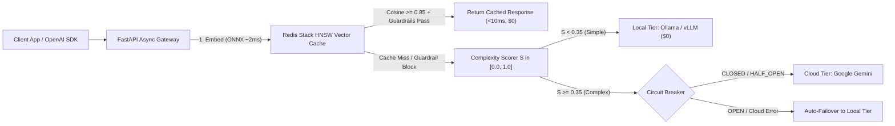

# Cost-Aware LLM Gateway & Semantic Caching Proxy

An OpenAI-compatible, cost-aware LLM API gateway that reduces inference costs and tail latency through **sub-10ms ONNX semantic caching**, **multi-factor prompt complexity routing**, and **automated circuit-breaker failover**.

---

## Architecture & Request Pipeline

Every `POST /v1/chat/completions` request flows through a 4-stage asynchronous pipeline:



1. **Sub-10ms Semantic Cache + Deterministic Guardrails (`src/cache/`):**
   * Generates 384-d normalized float32 embeddings on CPU via **ONNX Runtime (`FastEmbed`)** in $\sim 1\text{--}3\text{ms}$ (no heavy PyTorch runtime required).
   * Queries a **Redis Stack HNSW vector index** (`COSINE` distance).
   * Validates semantic hits ($\ge 0.85$) against a **Deterministic Guardrail** (`src/cache/guardrails.py`) that blocks false positives when numbers, years, or negation tokens diverge (e.g., `2024` vs. `2025` or `with tests` vs. `without tests`).
   * Offloads cache writes (`HSET` + `EXPIRE`) to FastAPI `BackgroundTasks` so caching adds $0\text{ms}$ to user latency.
2. **Multi-Factor Complexity Scorer (`src/routing/classifier.py`):**
   * Scores prompt difficulty $S \in [0.0, 1.0]$ in $<1\text{ms}$ across reasoning markers, code syntax indicators, prompt volume, and simple-task discounts.
3. **Hybrid Model Dispatch & 3-State Circuit Breaker (`src/routing/` & `src/client/`):**
   * Routes low-complexity prompts ($S < 0.35$) to a local OpenAI-compatible server (**Ollama** / **vLLM**).
   * Routes complex reasoning/coding prompts ($S \ge 0.35$) to **Google Gemini** (`google-genai` async client), protected by a `CLOSED -> OPEN -> HALF_OPEN` circuit breaker that automatically fails over to the local model on upstream errors or timeouts.
4. **OpenAI SDK Parity & Route Telemetry (`src/api/`):**
   * Drop-in replacement for the official `openai` Python SDK (`base_url="http://localhost:8000/v1"`).
   * Enriches every response with `gateway_metadata` and trace headers (`X-Gateway-Route`, `X-Gateway-Latency-Ms`, `X-Gateway-Cache-Hit`).

---

## Project Structure

```text
├── .env.example                 # Environment configuration template (no secrets)
├── pyproject.toml               # Project metadata, dependencies, pytest & ruff config
├── requirements.txt             # Pinned Python dependencies
├── test_openai_sdk.py           # Official OpenAI SDK verification script
├── src/
│   ├── main.py                  # FastAPI lifespan manager, CORS, exception handlers
│   ├── config.py                # Validated Pydantic BaseSettings loaded from .env
│   ├── api/
│   │   ├── dependencies.py      # Lifespan-scoped service container
│   │   ├── health.py            # GET /health & GET /v1/admin/stats
│   │   ├── router.py            # POST /v1/chat/completions pipeline
│   │   └── schemas.py           # OpenAI-compatible request/response models
│   ├── cache/
│   │   ├── embedder.py          # ONNX Runtime (FastEmbed) wrapper
│   │   ├── guardrails.py        # Numeric & negation divergence verifier
│   │   ├── redis_client.py      # Async Redis pool & HNSW index bootstrap
│   │   └── semantic_cache.py    # Async KNN lookup & background TTL write
│   ├── client/
│   │   ├── base.py              # Abstract async LLMClient contract
│   │   ├── cloud_client.py      # Async Google Gemini client with timeout enforcement
│   │   └── vllm_client.py       # Async OpenAI-compatible client (Ollama / vLLM)
│   ├── routing/
│   │   ├── circuit_breaker.py   # 3-state circuit breaker (CLOSED / OPEN / HALF_OPEN)
│   │   ├── classifier.py        # Heuristic complexity scorer S in [0.0, 1.0]
│   │   └── router.py            # Tier policy engine & failover orchestration
│   └── telemetry/
│       ├── logger.py            # Structured single-line JSON logger
│       └── stats.py             # In-process request & cost savings ledger
└── tests/
    └── unit/
        ├── test_circuit_breaker.py
        ├── test_classifier.py
        ├── test_guardrails.py
        └── test_schemas.py
```

---

## Quickstart

### 1. Prerequisites
* **Python 3.11+**
* **Redis Stack** running on `localhost:6379` (e.g., `docker run -d --name redis-stack -p 6379:6379 -p 8001:8001 redis/redis-stack:latest`)
* **Ollama** running locally with `llama3.2:1b` (`ollama pull llama3.2:1b`)

### 2. Environment Setup
```bash
python3 -m venv .venv
source .venv/bin/activate
pip install -r requirements.txt

cp .env.example .env
# Edit .env and set your GEMINI_API_KEY
```

### 3. Run the Gateway
```bash
uvicorn src.main:app --host 0.0.0.0 --port 8000 --reload
```
* **Interactive Swagger UI:** `http://localhost:8000/docs`
* **Health Check:** `http://localhost:8000/health`
* **Live Cost & Routing Stats:** `http://localhost:8000/v1/admin/stats`

### 4. Run Tests
```bash
pytest
python test_openai_sdk.py
```
