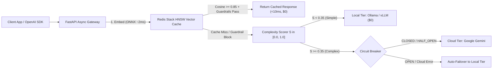

# Cost-Aware LLM Gateway & Semantic Caching Proxy

An OpenAI-compatible, cost-aware LLM API gateway that reduces inference costs and tail latency through **sub-10ms ONNX semantic caching**, **multi-factor prompt complexity routing**, and **automated circuit-breaker failover**.

---

## Architecture & Request Pipeline

Every `POST /v1/chat/completions` request flows through a 4-stage asynchronous pipeline:



1. **Sub-10ms Semantic Cache + Deterministic Guardrails (`src/cache/`):**
   * Generates 384-d normalized float32 embeddings on CPU via **ONNX Runtime (`FastEmbed`)** in $\sim 1\text{--}3\text{ms}$ (no heavy PyTorch runtime required).
   * Queries a **Redis Stack HNSW vector index** (`COSINE` distance).
   * Validates semantic hits ($\ge 0.85$) against a **Deterministic Guardrail** (`src/cache/guardrails.py`) that blocks false positives when numbers, years, or negation tokens diverge (e.g., `2024` vs. `2025` or `with tests` vs. `without tests`).
   * Offloads cache writes (`HSET` + `EXPIRE`) to FastAPI `BackgroundTasks` so caching adds $0\text{ms}$ to user latency.
2. **Multi-Factor Complexity Scorer (`src/routing/classifier.py`):**
   * Scores prompt difficulty $S \in [0.0, 1.0]$ in $<1\text{ms}$ across reasoning markers, code syntax indicators, prompt volume, and simple-task discounts.
3. **Hybrid Model Dispatch & 3-State Circuit Breaker (`src/routing/` & `src/client/`):**
   * Routes low-complexity prompts ($S < 0.35$) to a local OpenAI-compatible server (**Ollama** / **vLLM**).
   * Routes complex reasoning/coding prompts ($S \ge 0.35$) to **Google Gemini** (`google-genai` async client), protected by a `CLOSED -> OPEN -> HALF_OPEN` circuit breaker that automatically fails over to the local model on upstream errors or timeouts.
4. **OpenAI SDK Parity & Production Observability (`src/api/` & `src/telemetry/`):**
   * Drop-in replacement for the official `openai` Python SDK (`base_url="http://localhost:8000/v1"`).
   * Enriches every response with `gateway_metadata` and trace headers (`X-Gateway-Route`, `X-Gateway-Latency-Ms`, `X-Gateway-Cache-Hit`).
   * Exposes low-cardinality Prometheus metrics at `GET /metrics` and ships with a pre-provisioned 8-panel **Grafana Executive FinOps & SRE Dashboard** (`http://localhost:3000`).

---

## Project Structure

```text
├── .env.example                 # Environment configuration template (no secrets)
├── Dockerfile                   # Multi-stage build with pre-warmed offline ONNX model
├── docker-compose.yml           # 4-service stack: Redis Stack, Gateway, Prometheus, Grafana
├── Makefile                     # One-command stack lifecycle (make up / down / dev / test)
├── pyproject.toml               # Project metadata, dependencies, pytest & ruff config
├── requirements.txt             # Pinned Python dependencies
├── test_openai_sdk.py           # Official OpenAI SDK verification script
├── config/
│   ├── prometheus.yml           # 5s Prometheus scrape config for gateway:8000/metrics
│   ├── grafana_datasources.yml  # Auto-provisioned Prometheus datasource
│   ├── grafana_dashboards.yml   # Dashboard provider configuration
│   └── grafana_dashboard.json   # 8-panel FinOps & SRE Grafana dashboard
├── src/
│   ├── main.py                  # FastAPI lifespan manager, CORS, exception handlers
│   ├── config.py                # Validated Pydantic BaseSettings loaded from .env
│   ├── api/
│   │   ├── dependencies.py      # Lifespan-scoped service container
│   │   ├── health.py            # GET /health, GET /v1/admin/stats, GET /metrics
│   │   ├── router.py            # POST /v1/chat/completions pipeline
│   │   └── schemas.py           # OpenAI-compatible request/response models
│   ├── cache/
│   │   ├── embedder.py          # ONNX Runtime (FastEmbed) wrapper with thread-safe LRU
│   │   ├── guardrails.py        # Numeric, negation & style divergence verifier
│   │   ├── redis_client.py      # Async Redis pool & HNSW index bootstrap
│   │   └── semantic_cache.py    # Tier-isolated KNN lookup & background TTL write
│   ├── client/
│   │   ├── base.py              # Abstract async LLMClient contract
│   │   ├── cloud_client.py      # Async Google Gemini client with timeout enforcement
│   │   └── vllm_client.py       # Async OpenAI-compatible client (Ollama / vLLM)
│   ├── routing/
│   │   ├── circuit_breaker.py   # 3-state circuit breaker (CLOSED / OPEN / HALF_OPEN)
│   │   ├── classifier.py        # Hybrid lexical + semantic prototype complexity scorer
│   │   └── router.py            # Tier policy engine & failover orchestration
│   └── telemetry/
│       ├── logger.py            # Structured single-line JSON logger
│       ├── metrics.py           # Prometheus counters, histograms, and gauges
│       └── stats.py             # Unified in-process & Prometheus telemetry recorder
└── tests/
    ├── integration/
    │   └── test_chat_endpoint.py
    └── unit/
        ├── test_circuit_breaker.py
        ├── test_classifier.py
        ├── test_clients.py
        ├── test_guardrails.py
        ├── test_metrics.py
        ├── test_schemas.py
        └── test_semantic_cache.py
```

---

## Quickstart

### Option A: Full Stack via Docker Compose (Recommended)
1. Ensure **Docker Desktop** and **Ollama** (`ollama pull llama3.2:1b`) are running on your host.
2. Configure your `.env`:
   ```bash
   cp .env.example .env
   # Edit .env and set your GEMINI_API_KEY
   ```
3. Launch Redis Stack, Gateway, Prometheus, and Grafana:
   ```bash
   make up
   ```
   * **Grafana Dashboard (Zero-Click Home):** `http://localhost:3000`
   * **Prometheus UI:** `http://localhost:9090`
   * **Interactive Swagger UI:** `http://localhost:8000/docs`
   * **Health / Admin / Metrics:** `http://localhost:8000/health`, `http://localhost:8000/v1/admin/stats`, `http://localhost:8000/metrics`
   * Stop the stack anytime with `make down`.

### Option B: Local Python Development
```bash
python3 -m venv .venv
source .venv/bin/activate
pip install -r requirements.txt

make dev
```

### Run Tests
```bash
make test
python test_openai_sdk.py
```
